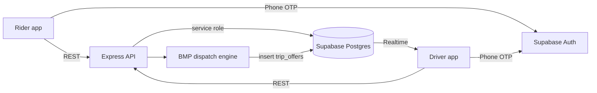
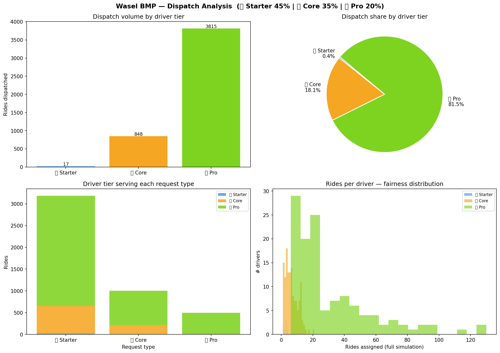

# Wasel — Ride-Hailing Prototype for MENA

Wasel is a two-sided ride-hailing platform designed for Jordan, built around a
driver-first business model: drivers pay a flat monthly subscription instead of
a per-trip commission, and their subscription tier feeds into dispatch
priority. This repository is the **first full prototype** (v1): a rider app,
a driver app, and a TypeScript dispatch backend on Supabase. The later Expo /
React Native rebuild lives in [Wasel-MVP](https://github.com/radalzubi/Wasel-MVP).

## What's in here

| Component | Path | Stack |
|-----------|------|-------|
| Rider app | `RIDER/Ride-hailing app for MENA/` | React 18, Vite, Tailwind, MUI/Radix, Google Maps, Capacitor (iOS/Android) |
| Driver app | `driver_app/` | React 18, Vite, Supabase Realtime, Capacitor |
| Backend API | `backend/` | Node.js, Express, TypeScript, Zod, Helmet, rate limiting |
| Database | `backend/supabase/` | Supabase Postgres, RLS policies, pg_cron, 9 migrations + seeds |
| Shared types | `shared/` | TypeScript types for drivers, riders and trips |
| Dispatch research | `RIDER/wasel_bmp/` | Python matching model + simulation notebook |
| Docs | `ARCHITECTURE.md`, `SETUP.md`, `docs/` | Architecture, dispatch flow, env vars, testing playbook |

## Architecture



### Trip lifecycle

1. The rider requests a trip (`POST /api/trips`) and the backend stores it as `requested`.
2. The dispatch engine scores every online, available driver within 5 km.
3. The best match gets a `trip_offers` row with a 15-second expiry, delivered to
   the driver app over Supabase Realtime. Expired offers are swept by `pg_cron`.
4. The driver accepts or declines (`POST /api/trips/:id/accept|decline`). A decline moves
   the offer to the next candidate.
5. The trip advances `accepted → en_route → arrived → in_progress → completed`,
   with every transition written to an append-only `trip_status_history` table.

## Dispatch: Best Match Priority (BMP)

`backend/src/dispatch_engine/scoring.ts` ranks candidates with a weighted score:

```
score = 0.40 × proximity      (linear falloff to 0 at the 5 km radius)
      + 0.30 × subscription   (tier weight: Silver 0.40, Gold 0.70, Platinum 1.00)
      + 0.20 × activity       (acceptance rate − cancellation rate)
      + 0.10 × idle bonus     (ramps to full after 10 minutes waiting)
```

The idle bonus keeps lower-tier drivers from starving, and every candidate's
score is written to `dispatch_log` so dispatch decisions can be audited.

`RIDER/wasel_bmp/` holds the research behind a later version of the protocol
(v3.0, `matching.py`): hard eligibility filters (ratings, vehicle condition,
capacity, shift-hour fatigue limits, ETA SLAs per ride product), ETA-first soft
scoring, and daily ride caps per subscription tier, evaluated in
`simulate.ipynb`.



## Features

**Rider app.** Phone-OTP login, map-based pickup and destination, ride
products (economy and comfort), fare summary in JD, trip history, saved
places, an "Explore Amman" screen, and a live Jordan news feed. Full **Arabic
and English** support and light/dark themes.

**Driver app.** Onboarding, online/offline toggle, real-time ride offers with
countdown, GPS-tracked navigation through each trip stage, earnings, trip
history and subscription management.

**Backend.** JWT auth middleware (`requireAuth`, `requireDriver`), Zod request
validation, Helmet and rate limiting, an admin API (metrics, dispatch log,
manual dispatch override), and an in-memory store fallback for development.

## Running locally

Prerequisites: Node.js 18+ and a Supabase project. `SETUP.md` covers this in
full; the short version:

```bash
# 1. Database: run backend/supabase/schema.sql, then the migrations in order
# 2. Configure each app from its .env.example
cp backend/.env.example backend/.env
cp "RIDER/Ride-hailing app for MENA/.env.example" "RIDER/Ride-hailing app for MENA/.env"

# 3. Install and start each service
npm --prefix backend install && npm run backend     # API on :3001
npm --prefix driver_app install && npm run driver   # driver app on :5174
npm --prefix "RIDER/Ride-hailing app for MENA" install && npm run rider   # rider app on :5173
```

Health check: `curl http://localhost:3001/health`

CI (`.github/workflows/ci.yml`) runs `npm ci` and `npm run build` for the
backend (tsc), the driver app (tsc + Vite) and the rider app (Vite) on every
push to `main` and every pull request.

### End-to-end flow test

`backend/tests/flow.js` drives the full ride (request → offer → accept → every
status transition → rider history) against a running backend:

```bash
cd backend && npm run test:flow:stack
```

### Native builds

Both apps are wrapped with Capacitor:

```bash
npm --prefix driver_app run build:ios && npm --prefix driver_app run open:ios
```

## Status

This was the v1 prototype and is no longer under active development. Work
continued in [Wasel-MVP](https://github.com/radalzubi/Wasel-MVP), and the
market and demand modelling lives in
[wasel-sim](https://github.com/radalzubi/wasel-sim).
